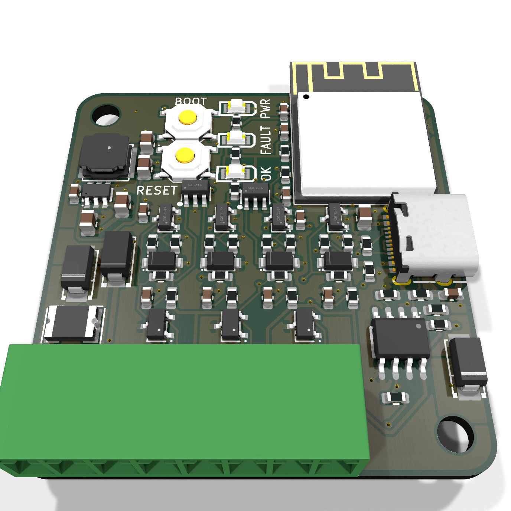

# Wiegand Bridge

Connect a standard **Wiegand keypad or card reader** to **Home Assistant**.

The reader plugs into this board, and the board sends every PIN and card it sees to Home Assistant
over Wi-Fi (ESPHome). Your automations decide what happens next: unlock a door, disarm an alarm,
or just log who came in.


> **Status: revision 10 is built, tested and working.** The files here are **revision 11**, which
> is routed and checked but not yet ordered: it adds a red/green status LED pair and cleans up the
> silkscreen (see [`docs/design.md`](docs/design.md)). The tested design is tag
> [`rev-10b`](https://github.com/EdgeCoil/wiegand-bridge/tree/rev-10b).

## Why it only reports

**The board never unlocks anything.** It has no output to a lock. The reader sits outside the door
where anyone can reach it, so the part that actually opens the door stays inside, behind Home
Assistant. Prising the board off the wall and shorting wires opens nothing.

A stolen board can still give away your Wi-Fi passphrase and its Home Assistant API key, which
are in its flash. [`docs/design.md`](docs/design.md) (*Security — assume it gets stolen*) covers
the precautions: an isolated IoT network, checking the event's `device_id` in your automation, and
alerting on the tamper switch.

## How it works

```
 keypad / card reader ──Wiegand──▶ Wiegand Bridge ──Wi-Fi──▶ Home Assistant ──▶ your lock, alarm, …
          ▲                                │                       │
          └──── beep + LED feedback ◀──────┴──── "granted" / "denied" ┘
```

1. Someone enters a PIN (4–10 digits, then `#`) or presents a card.
2. The board sends a Home Assistant event, `esphome.wiegand_bridge`, with `type` set to `code` or
   `fob` and the PIN or card number in `value`.
3. Your automation checks it and does whatever you want.
4. It calls `feedback_granted` or `feedback_denied` on the board. *Granted* pulses the reader's LED
   three times and then holds it for 3 s; *denied* beeps three times. Both show on the screen, if fitted.

The keypad also works as a **doorbell**: pressing `#` with nothing typed fires the board's
`doorbell` event entity. While someone types, the board's `entry` sensor shows one `*` per digit
(never the digits). `*` clears an entry, and an entry too short to submit is cleared rather than
joined to the next one.

A minimal automation:

```yaml
triggers:
  - trigger: event
    event_type: esphome.wiegand_bridge
    event_data: { type: code }
conditions:
  - condition: template
    value_template: "{{ trigger.event.data.value == states('input_text.door_pin') }}"
actions:
  - action: esphome.wiegand_bridge_feedback_granted
  - action: lock.unlock
    target: { entity_id: lock.front_door }
```

## Getting started

1. **Order the board** (see [Ordering](#ordering)). JLCPCB assembles almost everything.
2. **Wire the reader** to the reader terminals: J3 (`+12V`, `GND`), J10 (`D0`, `D1`) and J11 (`LED`,
   `BEEP`, optional). Set the reader to 26-bit Wiegand. Wire colours vary between readers, so follow
   your reader's own leaflet. The full connector list is in [`docs/design.md`](docs/design.md).
3. **Power it** from 6–36 V (screw terminal or 5.5 mm barrel jack, centre positive), or from USB-C on
   the bench.
4. **Flash the firmware** over USB-C with ESPHome: [`firmware/wiegand-bridge.yaml`](firmware/wiegand-bridge.yaml).
   It needs four entries in your `secrets.yaml`: `wifi_ssid`, `wifi_password`,
   `wiegand_bridge_api_key` and `wiegand_bridge_ota_password`. If you've fitted the OLED, uncomment
   the `packages:` block at the end so it includes [`wiegand-bridge-oled.yaml`](firmware/wiegand-bridge-oled.yaml).
5. **Adopt it in Home Assistant** (ESPHome integration) and write your automation.

For the first power-up, follow the staged bench tests at the end of [`docs/design.md`](docs/design.md).

## Features

**Reader**
- Wiegand D0/D1 through a 5 V-tolerant Schmitt buffer, clamped against 12 V miswiring
- Open-drain LED and BEEP outputs back to the reader
- RS-485 port (SP3485) for OSDP readers, with jumper-selectable termination and bias

**Power**
- 6–36 V input, reverse-polarity and surge protected
- Regulated reader supply from every power source: 12.6 V (13.2 V by solder jumper), with current
  sensing, voltage monitoring and firmware-controlled shedding
- LiFePO4 backup: on-board charger (CN3058E, 3.6 V), cell protection (DW01A + FS8205A),
  thermistor-gated charging, seamless handover when external power drops

**Sensing and display**
- Tamper switch under the lid, plus a header for an enclosure-mounted one
- Four dry-contact inputs (door contact, exit button and so on), 24 V-tolerant
- Socket for a 1.3" SH1106 OLED (I²C), plus an SPI header for a TFT or e-paper

**Brains and expansion**
- ESP32-S3-WROOM-1-N8R2 with Wi-Fi and BLE; native USB-C for flashing and logs
- Status LEDs: red `FAULT` (warnings and errors) and green `OK` (connected to Home Assistant)
- TCA9535 expander for status lines and spares; Qwiic, W5500 Ethernet and 2×6 expansion headers
- SM712 surge and ESD protection on every field wire
- Optional relay footprint, **not fitted** by default (see *Security* in the design doc)

**Board:** 90 × 95 mm, 4 layers, assembled by JLCPCB.

## LITE (in development)

A 42 × 44 mm sibling for readers that already have their own supply: ESP32-S3-MINI-1, 8–16 V in,
USB-C, one 8-way pluggable terminal, and RS-485. Its D0/D1/LED/BEEP lines all work both ways, so it
can also pretend to be a reader towards an existing access controller.

**Designed, routed and checked, but no board made yet.** See [`docs/lite.md`](docs/lite.md),
[`hardware/lite/`](hardware/lite/) and [`firmware/wiegand-bridge-lite.yaml`](firmware/wiegand-bridge-lite.yaml).

| LITE | Next to the full board |
|---|---|
|  |  |

## What's in this repository

| Path | What it is |
|---|---|
| [`firmware/`](firmware/) | ESPHome configurations: the full board and its optional OLED package, the LITE, and a bench-only LITE emulation package |
| [`docs/design.md`](docs/design.md) | How it works, pin map, connectors, security notes and bench tests |
| [`docs/breadboard.md`](docs/breadboard.md) | A through-hole breadboard version, for trying your reader before ordering |
| [`docs/lite.md`](docs/lite.md) | The LITE board in detail |
| [`hardware/`](hardware/) | The board, **generated from Python** (`netlist.py` is the source of truth) |
| [`hardware/fab/`](hardware/fab/) | Ready-to-order files: Gerbers, BOM, placement, schematic and assembly PDFs, renders |
| [`hardware/sim/`](hardware/sim/) | ngspice checks of the analogue corners |
| [`hardware/lite/`](hardware/lite/) | The LITE board's scripts and outputs |

## Ordering

1. Upload `hardware/fab/wiegand-bridge-gerbers.zip` to JLCPCB and choose **4 layers**.
2. Turn on **PCB Assembly**, top side, and upload `wiegand-bridge-bom.csv` and `wiegand-bridge-cpl.csv`.
3. **Check every polarised part in the placement preview** before confirming: diodes, LEDs, ICs,
   the ESP32 and the USB-C. On rev 11, look especially at the status LEDs D8 and D23 (D8 changed
   footprint family).

JLCPCB doesn't fit the battery connector housing and cell, the OLED module, or any unpopulated
headers. Add those yourself.

## Rebuilding the board

Everything under `hardware/` is produced by scripts, so the board can be rebuilt after any change.

| Script | What it does |
|---|---|
| `netlist.py` | Every part, its JLCPCB part number, and which net each pad joins |
| `placement.py` | Where each part sits |
| `build_pcb.py` | Makes `wiegand-bridge.kicad_pcb`, unrouted, from the two files above |
| `route.py` | Thermal vias, hand routes for the fine-pitch parts, GND fan-out, Freerouting, pours |
| `stitch.py`, `via_fix.py`, `gndcheck.py`, `dfm_post.py`, `audit.py` | Stitching, vias out of pads, ground connectivity, paste and pours, mechanical and current audit |
| `finish_net.py` | Routes one straggling connection by grid A* if Freerouting leaves one |
| `schematic.py` | A readable schematic PDF from the netlist |
| `fab.py` | JLCPCB outputs into `fab/` |

```bash
cd hardware
python3 build_pcb.py                       # needs KiCad 9's pcbnew Python module
ROUTE_WORK=/tmp/wb python3 route.py 30     # needs Java + Freerouting 2.4.x
python3 stitch.py && python3 stitch.py --islands
python3 via_fix.py                         # must report 0 vias inside pad openings
python3 gndcheck.py
python3 dfm_post.py
python3 audit.py
python3 fab.py
kicad-cli pcb drc wiegand-bridge.kicad_pcb
```

Tools: KiCad 9.0, Freerouting 2.4.1 (OpenJDK), `easyeda2kicad` 1.0.1 (for `lib/`), ngspice 44.

<details>
<summary>3D models (not included)</summary>

The models come to about 60 MB, so they aren't in the repository; the renders in `fab/` show the
board with them. To fetch them, run `easyeda2kicad --3d --lcsc_id=<part> --output hardware/lib/wb`
for the LCSC part numbers in the BOM. The 0603/0805 passives use KiCad's stock footprints, whose
models come from `kicad-packages3d`: `fab.py` looks for them in `~/.local/share/kicad/9.0/3dmodels`
(three files: `Resistor_SMD.3dshapes/R_0603_1608Metric`, `Capacitor_SMD.3dshapes/C_0603_1608Metric`
and `C_0805_2012Metric`, `.step` + `.wrl`, from gitlab.com/kicad/libraries/kicad-packages3D).

</details>

## Licence

| What | Licence |
|---|---|
| The board: everything in `hardware/`, including the scripts that define it (`netlist.py`, `placement.py`, `build_pcb.py`, `route.py`), the simulations and the fabrication outputs | [CERN-OHL-S-2.0](LICENSES/CERN-OHL-S-2.0.txt) |
| Firmware and the general-purpose build tools (every other script in `hardware/`) | [MIT](LICENSES/MIT.txt) |
| Documentation (`README.md`, `docs/`) and the renders | [CC BY 4.0](LICENSES/CC-BY-4.0.txt) |

Each source file carries an SPDX header, and [`REUSE.toml`](REUSE.toml) covers the rest by path.

CERN-OHL-S is strongly reciprocal. You may build, modify and sell boards from this design, but if
you ship a modified version you must publish its source under the same licence. The source lives at
https://github.com/EdgeCoil/wiegand-bridge, linked from the board's back silkscreen as
`wiegand.edgecoil.dev`.

**The edgecoil name and mark are not licensed.** Remove the mark from the silkscreen of any boards
you make or sell, and don't sell them under the edgecoil name.

The design is provided as is, with no warranty. It is an access-control accessory, so you are
responsible for the security of any installation.

---

edgecoil · [edgecoil.dev](https://edgecoil.dev)
