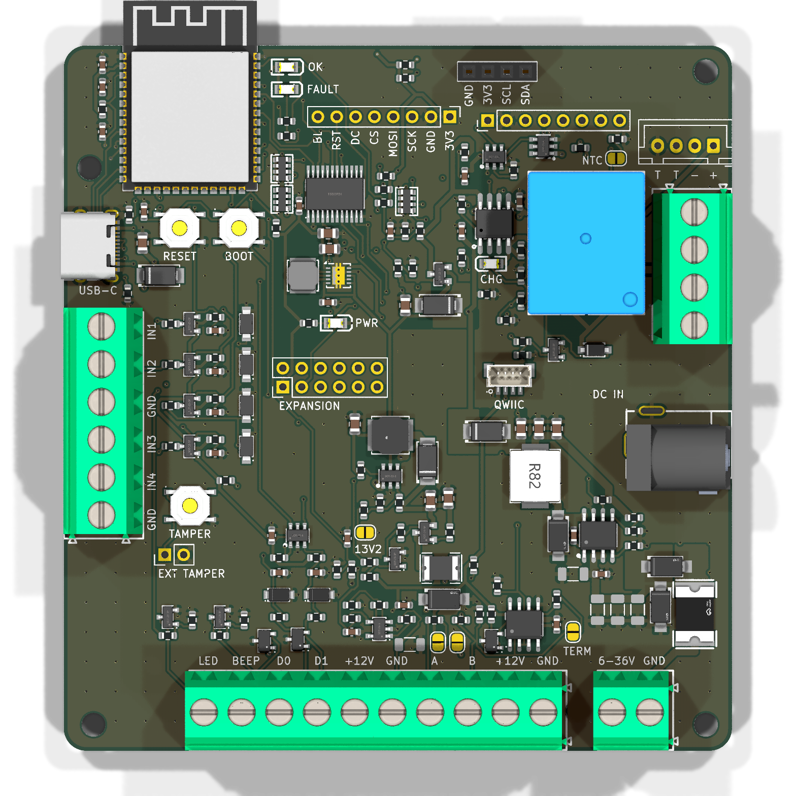
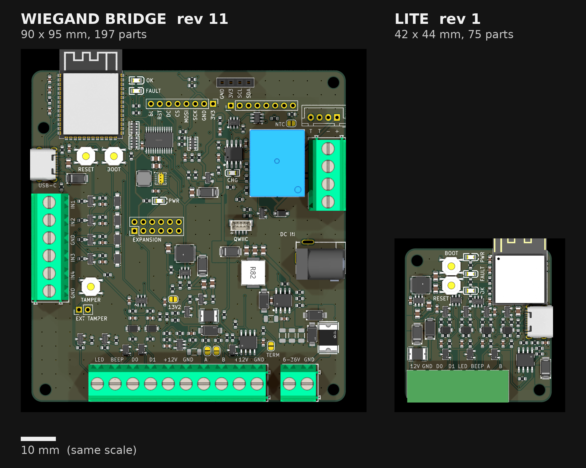

# wiegand-bridge

An ESP32-S3 board that connects a standard **Wiegand keypad / card reader** to **Home Assistant**
through ESPHome. The reader's codes and card numbers reach HA as events; HA decides what happens.

**The board only reports.** It has no output toward a lock. It is designed for the reader side of a
door, where anyone can reach it, so the part that unlocks anything stays somewhere else.



> **Status: revision 10, first boards in manufacture, not yet tested on hardware.** The files here
> are rev 10b, which differs only in the back silkscreen (it adds the source link). Treat
> everything here as unverified until the bench tests in [`docs/design.md`](docs/design.md) pass.

## Features

- **ESP32-S3-WROOM-1-N8R2**, with Wi-Fi and BLE; native USB-C for flashing and logs
- **6–36 V input** (screw terminal or 5.5 mm barrel jack, centre positive), reverse-polarity and surge protected
- **Regulated reader supply** (12.6 V boost, or 13.2 V by solder jumper) from every power source,
  with current sensing, voltage monitoring and firmware-controlled shedding
- **Wiegand D0/D1** through a 5 V-tolerant Schmitt buffer, clamped against 12 V miswiring;
  open-drain **LED** and **BEEP** outputs to the reader
- **LiFePO4 backup**: on-board charger (CN3058E, 3.6 V), cell protection (DW01A + FS8205A),
  thermistor-gated charging, seamless handover when external power drops
- **Tamper switch** under the lid, plus a header for an enclosure-mounted one
- **Four dry-contact inputs** (door contact, exit button, etc.), 24 V-tolerant
- **1.3" SH1106 OLED** socket (I²C), plus an SPI header for a TFT or e-paper
- **RS-485** port (SP3485) for OSDP readers, with jumper-selectable termination and bias
- **TCA9535** expander for status lines and spares; **Qwiic**, **W5500** Ethernet and 2×6
  expansion headers
- **SM712** surge/ESD protection on every field wire
- Optional **relay** footprint, not fitted by default (see *Security* in the design doc)
- 90 × 95 mm, 4 layers, assembled by JLCPCB

## LITE — under development

A 42 × 44 mm sibling for the case where the reader already has its supply: ESP32-S3-MINI-1,
8–16 V in, USB-C, one 8-way pluggable terminal, D0/D1/LED/BEEP all bidirectional (it can also
emulate a reader toward an access controller), RS-485 kept. **Designed, routed and checked; no
board made yet.** [`docs/lite.md`](docs/lite.md), [`hardware/lite/`](hardware/lite/),
[`firmware/wiegand-bridge-lite.yaml`](firmware/wiegand-bridge-lite.yaml).



## Repository layout

| Path | What it is |
|---|---|
| [`hardware/`](hardware/) | The board, **generated from Python**: `netlist.py` is the source of truth |
| [`hardware/fab/`](hardware/fab/) | Ready-to-order outputs: Gerbers, BOM, CPL, schematic and assembly PDFs, renders |
| [`hardware/sim/`](hardware/sim/) | ngspice checks of the analogue corners |
| [`hardware/lite/`](hardware/lite/) | **The LITE board (under development)**: its own `netlist.py`/`placement.py`, the same scripts trimmed, `fab/` outputs |
| [`firmware/`](firmware/) | ESPHome configurations (full board, and `wiegand-bridge-lite.yaml`) |
| [`docs/design.md`](docs/design.md) | How it works, pin map, connectors, security notes, bench tests |
| [`docs/breadboard.md`](docs/breadboard.md) | A through-hole breadboard version for trying the reader first |
| [`docs/lite.md`](docs/lite.md) | The LITE board: what it is, the bidirectional line cell, pin map, results, checks before ordering |

## Building the board

Everything under `hardware/` is produced by scripts, so the board can be rebuilt after any change.

| Script | Does |
|---|---|
| `netlist.py` | Every part, its JLCPCB part number, and which net each pad joins |
| `placement.py` | Where each part sits |
| `build_pcb.py` | Makes `wiegand-bridge.kicad_pcb`, unrouted, from the two files above |
| `route.py` | Thermal vias, hand routes for the fine-pitch parts, GND fan-out, Freerouting, pours |
| `stitch.py`, `via_fix.py`, `gndcheck.py`, `dfm_post.py`, `audit.py` | Stitching, vias out of pads, ground connectivity, paste and pours, mechanical and current audit |
| `finish_net.py` | Routes one straggling connection by grid A* if Freerouting leaves one |
| `schematic.py` | A readable schematic PDF from the netlist |
| `fab.py` | JLCPCB outputs into `fab/` |

```bash
cd hardware
python3 build_pcb.py                       # needs KiCad 9's pcbnew Python module
ROUTE_WORK=/tmp/wb python3 route.py 30     # needs Java + Freerouting 2.4.x
python3 stitch.py && python3 stitch.py --islands
python3 via_fix.py                         # must report 0 vias inside pad openings
python3 gndcheck.py
python3 dfm_post.py
python3 audit.py
python3 fab.py
kicad-cli pcb drc wiegand-bridge.kicad_pcb
```

Tools used: KiCad 9.0, Freerouting 2.4.1 (OpenJDK), `easyeda2kicad` 1.0.1 (for `lib/`), ngspice 44.

**3D models are not included** (about 60 MB). The renders in `fab/` show the board with them. To
fetch them, run `easyeda2kicad --3d --lcsc_id=<part> --output hardware/lib/wb` for the LCSC part
numbers in the BOM. The 0603/0805 passives use KiCad's stock footprints, whose models come from
`kicad-packages3d`; `fab.py` looks for them in `~/.local/share/kicad/9.0/3dmodels` (three files:
`Resistor_SMD.3dshapes/R_0603_1608Metric`, `Capacitor_SMD.3dshapes/C_0603_1608Metric` and
`C_0805_2012Metric`, `.step` + `.wrl`, from gitlab.com/kicad/libraries/kicad-packages3D).

## Ordering

Upload `hardware/fab/wiegand-bridge-gerbers.zip` to JLCPCB (4 layers), choose PCB Assembly
on the top side, then upload `wiegand-bridge-bom.csv` and `wiegand-bridge-cpl.csv`. **Check every
polarised part in the placement preview** before confirming: diodes, LEDs, ICs, the ESP32 and the
USB-C.

Not assembled by JLCPCB: the battery connector housing and cell, the OLED module, and any
unpopulated headers.

## Licence

| What | Licence |
|---|---|
| The board: everything in `hardware/`, including the scripts that define it (`netlist.py`, `placement.py`, `build_pcb.py`, `route.py`), the simulations and the fabrication outputs | [CERN-OHL-S-2.0](LICENSES/CERN-OHL-S-2.0.txt) |
| Firmware and the general-purpose build tools (every other script in `hardware/`) | [MIT](LICENSES/MIT.txt) |
| Documentation (`README.md`, `docs/`) and the renders | [CC BY 4.0](LICENSES/CC-BY-4.0.txt) |

Each source file carries an SPDX header, and [`REUSE.toml`](REUSE.toml) covers the rest by path.

CERN-OHL-S is strongly reciprocal. You may build, modify and sell boards from this design, but if you
ship a modified version you must publish its source under the same licence.
**Source location:** https://github.com/EdgeCoil/wiegand-bridge, linked from the board's back
silkscreen as `wiegand.edgecoil.dev`.

**The edgecoil name and mark are not licensed.** Remove the mark from the silkscreen of any boards
you make or sell, and don't sell them under the edgecoil name.

The design is provided as is, with no warranty. It is unverified on hardware (see *Status*). It is
an access-control accessory, so you are responsible for the security of any installation.

---

edgecoil · [edgecoil.dev](https://edgecoil.dev)
