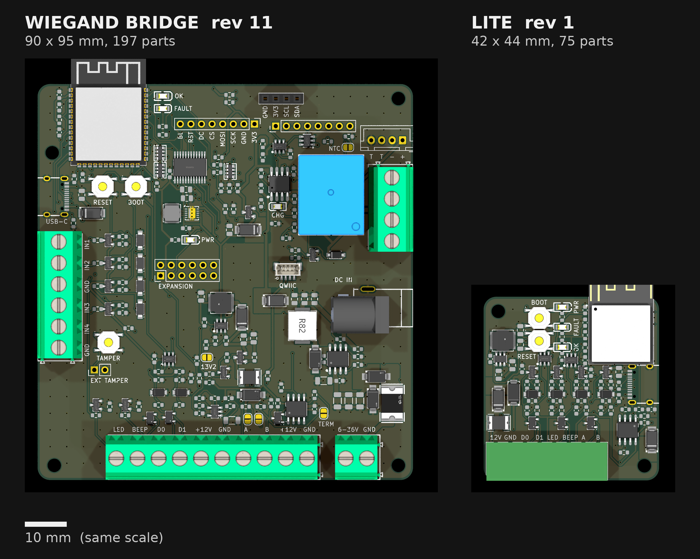

# Wiegand bridge LITE — design notes, revision 2

**Status: under development.** Revision 1 was designed, routed and checked on 2026-10-21; revision 2
(2026-10-27, below) takes its review's three open items, a passive-to-IC audit and that audit's own
review, and grows the board to 42 × 47 mm to fit them. The firmware
compiles; **no board has been made.** Nothing here is verified on hardware. Files: [`hardware/lite/`](../hardware/lite/),
[`firmware/wiegand-bridge-lite.yaml`](../firmware/wiegand-bridge-lite.yaml).



## What it is

The smallest board that puts an ESP32 on a Wiegand reader. It assumes the reader has its own supply,
runs from **12 V ± 4 V (8–16 V)**, keeps **USB-C** for programming (and bench power), and has
**two lines for the reader's LED and buzzer**. No battery, screen, relay or switch inputs.

| | Full board (rev 12) | Lite (rev 2) |
|---|---|---|
| Size, layers | 90 × 95 mm, 4 | **42 × 47 mm**, 4 (rev 1: 42 × 44) |
| Module | ESP32-S3-WROOM-1-N8R2 | **ESP32-S3-MINI-1-N4R2** (15.4 × 20.5 mm; same chip family) |
| Input | 6–36 V, two regulators, battery, 12 V boost for the reader | **8–16 V → AP63203 → 3.3 V**, one stage; the reader has its own supply |
| USB-C | programming and power | programming, **and bench power through one Schottky diode** |
| Reader lines | D0/D1 inputs, LED/BEEP outputs | **D0, D1, LED, BEEP all bidirectional** |
| RS-485 / OSDP | THVD1420, termination and bias jumpers, node-power terminal | THVD1420 (full fail-safe), termination jumper only |
| Connectors | 11 screw terminals, OLED socket, headers | **one 8-way 3.5 mm pluggable block**: `12V GND D0 D1 LED BEEP A B` |
| Status LEDs | PWR, FAULT, OK, CHG | PWR, FAULT (ESPHome status), OK (API connected) |
| Reset | RC on EN | **TPS3808 supervisor on EN**; RESET button on its MR input |
| Parts | 200 | **82** (34 part numbers) |

The security model is the full board's ([design.md](design.md), *Security*): the board reports
credentials to Home Assistant as events and has no output toward a lock.

## Revision 2

| Change | Why |
|---|---|
| **U9 THVD1420** (C3235215) replaces the SP3485; the 20k bias pair R66/R67 is gone | Its receiver has full fail-safe: an idle, open or shorted bus reads as a 1. Rev 1's weak bias gave ~10 mV with the termination fitted, so an idle terminated bus was undefined |
| **U3 TPS3808G30** (C189211) on EN; SW2 moves to its MR input | Open-drain, holds EN low until +3V3 passes 2.79 V, then 20 ms more (CT open). A start from a slow or pre-biased rail is defined, and the button is debounced |
| **Q1–Q4 AO3400A** (C20917, Basic) replace the 2N7002s | Fully on at a 3.3 V gate: the 2N7002's 2.5 V worst-case threshold left ~15–20 mA, marginal for a controller's 1k pull-up to 12 V |
| **D26 BAT54** (C22466368, Preferred) feeds the four line pull-ups (`+3V3_PU`) | A reader powered while the board is not no longer back-feeds the dead 3.3 V rail through each line's 1k + 10k |
| **C1/C2 1206 50 V** (C13585) replace the 0805 25 V parts | The 0805s held 40–55 % of 10 µF at 12–16 V bias |
| **R86** 1 kΩ between U3's RESET and EN | U3 discharged C13 (1 µF) unlimited: ~35 mA against its 5 mA absolute maximum. EN low is now 0.30 V |
| **C45** 10 nF on MR | 28 mm of route beside other signals, into an input that reacts to ~1 ns pulses |
| **R95** 4.7 kΩ from `+3V3_PU` to GND (in round 1's C46 land; C46 removed) | D26 can't sink, so a reader's own 5 V pull-ups lifted the rail to ~4.9 V and the line's low level with it (audit round 2) |
| **R87** 1.5 kΩ on VBUS | D3's reverse leakage charged an unplugged VBUS toward +VIN; a Type-C source waits for VBUS under 0.8 V (100 kΩ in round 1 held it only below ~45 °C) |
| **D1 SS56** (60 V, C18199169, Preferred) replaces the SS34 | In a negative surge D2 holds +VIN_F at −29 V while the input capacitors hold +VIN at up to 16 V: 45 V across D1 |
| **R88/R89** 10 Ω, pulse-proof (C844519) between the SM712 and U9's A/B | The SM712 clamps above the THVD1420's ±16 V (TI's surge reference circuit). They cost drive: about 1.24 V on a doubly terminated bus at 3.3 V, under TIA-485's 1.5 V; receivers need 0.2 V, so a bus of fail-safe nodes is fine |
| **D2 SMAJ18CA** (C19077539, bidirectional) on +VIN_F, ahead of D1 | A negative surge meets the TVS rather than D1's 40 V reverse rating; a reversed 12 V supply is still blocked by D1 |
| **R3/R81** 470 Ω | The green LEDs' Vf (up to 3.1 V) left 0.3–0.7 mA through 1 kΩ |
| Two GND vias and an F.Cu link from U2's GND pin to C2's | The buck's input loop closed through single vias |
| A top-layer track keep-out under J1's shell | RS485_RO had run 9.5 mm there; `verify.py` now checks it |

The board grew 3 mm in a band below the line cells, which holds R86, C45, R95 and R88/R89. U3 sits
at the bottom right, between D19 and U9, because the column beside the module's EN parts holds the
status LEDs' labels. EN and the button line are slow signals, routed in from there.

## The bidirectional line cell

Each of the four reader wires carries the full board's input cell **and** its output cell:

```
wire ──┬── SM712 (one per pair) ── GND
       ├── AO3400A drain     gate ← 100 Ω ← GPIO (drive)      100k gate → GND
       └── 1k ──┬── 5.1 V zener ── GND
                ├── 100 pF ── GND
                ├── 10k ── +3V3_PU (BAT54 from 3V3)
                └── 74LVC2G17 Schmitt buffer ── GPIO (sense)
```

- **Reader mode:** the reader drives D0/D1 low; the board senses them on IO4/IO5 (the same pins and
  the same `wiegand:` block as the full board) and drives LED/BEEP low (IO8/IO9).
- **Emulation mode** (the board stands in for a reader at an access controller's terminals): the
  board pulses D0/D1 low (IO6/IO7); the controller drives LED/BEEP, sensed on IO10/IO11.
- The drive FET sits on the raw wire, before the 1k, so it sinks whatever pull-up the far end has.
  The SM712 stands off 12 V on the wire and breaks down from ~13 V (clamp 19 V at 1 A): a surge
  part, not a limiter for a wire held high. The 10k pull-up to 3.3 V keeps a disconnected line
  idle-high, so `wiegand:` stays quiet.
- The board hears its own pulses: a frame sent in emulation mode also arrives as a tag on IO4/IO5
  and reaches HA as a fob event — which is why emulation is a bench-only package (below).
- The drive FET is an AO3400A since rev 2 (rev 1's 2N7002 was specified at a 5 V gate, and at
  3.3 V with its worst-case 2.5 V threshold sank only ~15–20 mA).
- The 10k pull-ups hang off `+3V3_PU`, fed from 3.3 V through D26 (BAT54), so the idle-high node
  sits a diode drop below 3.3 V (about 2.95 V), still well above the buffer's 2.0 V threshold. D26
  can't sink current, so R95 (4.7 kΩ) holds the rail down when the far end has pull-ups of its own.
- **The reader's output must pull a line to 0.53 V or lower** (at about 0.3 mA; 0.46 V where a
  controller's 12 V/1k pull-ups are also on the line). The buffer node sits at the reader's low level
  plus 1/11 of the difference to the rail, and the 74LVC2G17's low threshold can be as low as 0.8 V.
  Simulated (audit round 2's deck, with R95 and without C46) with a reader holding 5 V/1k pull-ups on
  D0/D1: limit 0.536 V; nothing else attached: 0.582 V. Open-collector and open-drain readers meet
  this; check a reader with a series resistor in its outputs.

ESPHome has no Wiegand transmitter, so `wiegand_tx` bit-bangs one in a lambda: 50 µs low per bit,
2 ms between bits, a 1 on D1 and a 0 on D0. `wiegand_send_26` builds the standard 26-bit frame
(even parity over the first 12 bits, odd over the last 12) from a facility code and a card number;
parity and bit order were traced by hand and against ESPHome's receiver. **Both live in
`firmware/wiegand-bridge-lite-emulation.yaml`, a package that a door build must not include.** They
are HA → device actions: HA registers them as services whenever the device is connected, and the
ESPHome integration's "allow the device to perform actions" switch does not gate them (it gates
device → HA calls). Any HA automation or any client holding the API key could replay a known card
number through the board, and the board's own echo would deliver it to HA as a presented fob. An
earlier version of this page said the switch covered it; it does not. `value` is an int32, so
frames are at most 31 bits.

## Power

- **8–16 V in**, terminal pins 1–2: 0.5 A hold / 1 A trip 24 V PTC, then D2, an SMAJ18CA
  (bidirectional, 18 V standoff each way; clamp 29 V at 13.7 A, under the AP63203's 35 V absolute
  maximum). Then the SS56 (60 V) in series for reverse polarity: a reversed 12 V supply sits under D2's
  standoff and is blocked by D1, and a negative surge clamped at −29 V puts at most 45 V across it. Then 10 µF (1206, 50 V).
- **Do not wire it to a 24 V supply** (common in access control). D2 conducts from about 20 V, and
  the PTC is rated 24 V, so a 24 V supply heats D2 until the PTC trips and can then exceed the PTC's
  rating.
- **AP63203** (fixed 3.3 V, 3.8–32 V in, 2 A, TSOT-26) close to its datasheet's typical circuit: 10 µF
  in, 2 × 22 µF out, 100 nF bootstrap, 4.7 µH (3 A rated, 3.9 A saturation; Table 2 gives 3.9 µH, and
  4.7 µH is inside its 2.2–10 µH range), EN tied to VIN (the
  datasheet allows it directly; EN's absolute maximum is 35 V), FB tied to VOUT. The part is
  flagged "not recommended for new designs" at LCSC; check stock before ordering. Fallback: the
  full board's LMR16020 at 3.3 V. The input capacitors are the full board's 1206 50 V part
  (C13585) since rev 2; rev 1's 0805 25 V parts held only 40–55 % of 10 µF at 12–16 V.
- **USB-C VBUS → SS34 → the buck input.** With 12 V present the diode is reverse-biased; from USB
  alone the buck sees 4.6 V (minimum 3.8). No ESD part on D+/D− (the port is inside the enclosure).
  R87 (1.5 kΩ) bleeds D3's reverse leakage off VBUS when no cable is attached: at the SS34's
  guaranteed 0.5 mA that is 0.75 V, under the 0.8 V a Type-C source waits for before it attaches. On USB alone the host
  sees C6 plus the buck's input capacitors (about 26 µF effective), more than USB 2.0's 10 µF:
  that's fine for bench use from a PC or a USB charger, but don't hot-plug it into a hub port that
  enforces inrush limits.
- Load: the S3 (≤ 0.5 A peaks on Wi-Fi), THVD1420, two buffers, three LEDs: ~0.15 A at 12 V.
- **Back-feed when the reader is powered and the board is not** (the full board never had this
  case, because it powered the reader): in rev 1 the reader's 5 V pull-ups reached the dead 3.3 V
  rail through each cell's 1k + 10k, and the module could start from a pre-biased rail. Rev 2
  blocks that path with D26 and, separately, holds EN low until the rail is good (U3).
- **Reset:** U3 TPS3808G30 drives EN through R86 1 kΩ (open drain, R4 10k pull-up, C13 1 µF kept):
  EN is released 12–28 ms after +3V3 passes 2.79 V. SW2 (RESET) pulls U3's MR input, which has its own
  70–90k pull-up and C45 10 nF against noise.

## Pin map

| GPIO | Function | | GPIO | Function |
|---|---|---|---|---|
| IO4 / IO5 | D0 / D1 sense (buffered) | | IO38 | RS-485 DE (held in receive by R65; claimed by the firmware as an output driven low) |
| IO6 / IO7 | D0 / D1 drive (open drain) | | IO43 / IO44 | RS-485 TX / RX (UART0) |
| IO8 / IO9 | LED / BEEP drive | | IO21 | red FAULT (ESPHome status LED, sink) |
| IO10 / IO11 | LED / BEEP sense (buffered) | | IO47 | green OK (sink) |
| IO0 | BOOT | | IO19 / IO20 | USB D− / D+ |

IO3, IO45, IO46 (strapping) and IO26 (PSRAM on the N4R2) are not connected. The module's pad
numbers → GPIOs come from its EasyEDA symbol and are recorded in `netlist.py`.

**Terminal, left to right:** `12V GND D0 D1 LED BEEP A B` — KF2EDGR-3.5-8P header (C441177);
mating plug KF2EDGK-3.5-8P, not on the BOM. The header's mouth is placed at the bottom edge. By its
drawing the body stands about 0.1 mm past the edge, and its courtyard 0.23 mm.

## Layout

- The module's top edge sits ~4 mm above the board edge, but the MINI-1's antenna is the top
  5.05 mm of the module (datasheet figure 11-1), so the last ~1 mm of the antenna area lies over
  the board. A rule area (`antenna_keepout`, all four copper layers) keeps pours, tracks and vias
  out of the strip between the edge and the module's GND pads 46–60. The first routed board did
  not have it (the pours ran to the edge under the antenna); the 2026-10-21 review found it, and
  it was added without a re-route since nothing but pour lay in the strip.
- The module's EN / UART / IO38 column faces the right edge, its IO0–IO11 column faces inboard,
  where the line cells are.
- The four line cells stand in columns above their terminal pins with the surge parts at the
  terminal; the buck and input chain run down the left edge from the top-left hole; the USB-C is
  on the right edge below the module.
- Silkscreen text is ≥ 1.0 mm, JLCPCB's minimum (the back-side title and URL are 1.2 mm); the
  only part on the back is the termination jumper.
- **Parts are spaced by pad extents, not courtyards.** The EasyEDA footprints' courtyards stop
  short of their pad ends (SMA, SOT-23 and TSOT pads run up to 0.9 mm past them), so three routing
  attempts failed on pads that overlapped while the courtyard check passed. `padgap.py` measures
  pad-to-pad gaps on the unrouted board (≥ 0.25 mm between different nets) and is part of the
  pre-route checks. The `courtyards_overlap` DRC warnings between neighbouring passives (12 in rev 2)
  remain and are accepted; `verify.py` checks each such pair's pads are ≥ 0.25 mm apart.
- `route.py` lays some copper itself before Freerouting:
  - the USB-C's VBUS pad pair;
  - USB D+/D− as routed in rev 2's first reviewed layout (each through an In2 via): Freerouting left D−
    open in every attempt after the rev 2 additions;
  - U2/C2's ground link and vias;
  - the 0.5 mm stub from R87 to D3's VBUS pad.
- A rule area keeps top-layer tracks out from under J1's shell (stitching vias stay allowed).

## Results, revision 2

- Freerouting after the hand routes above: **0 unconnected** on the fourth attempt. `route.py` exits
  non-zero on anything unconnected; the first three attempts each left one VBUS connection open.
  The routing is frozen in `routing.json`.
- `verify.py`: ALL CHECKS PASSED. No foreign track under J1; all 85 GND pads on the plane; no orphan
  pour islands; the antenna keep-out empty; 0 pad pairs closer than 0.25 mm. DRC shows only the
  accepted classes: 4 hole_clearance at J1's pegs, 12 courtyard overlaps, and silk.
- JLCPCB classes: rev 2 adds three fee-bearing Extended types (THVD1420, TPS3808G30 and the
  pulse-proof 10 Ω), so ten in all. That is about US$9 more per order than the rev 1 costing below.
  The BAT54 and SMAJ18CA are Preferred, and the AO3400A, 470 Ω and 10 nF are Basic.

## Results, revision 1

- Freerouting (60 passes) after a hand route of the USB-C's VBUS pad pair, which it never joins:
  **0 unconnected**, no clearance, short or starved-thermal items. 0 vias in pads, every ground
  pad on the plane, no orphan pour islands.
- Track widths: 0.5 mm on the raw input and switch nets (0.12–0.22 mm needed), 0.38 mm minimum
  on the buck input, 0.18 mm minimum on 3.3 V (0.15 needed), 0.4 mm on VBUS; signals 0.2 mm /
  0.15 mm clearance (JLCPCB 4-layer allows 0.09).
- Cross-checks from the files (`verify.py`, 12 sections): every GPIO the board wires is claimed by
  the firmware and lands on the intended net, on through each cell to its terminal pin; every
  diode's cathode/anode matches its symbol; the module's open pads are exactly the planned set;
  BOM = CPL (72 placements, top side); gerbers, drills and CPL in one frame on both axes; the
  antenna keep-out present and empty; USB D+/D− on IO20/IO19; strapping pins open, IO0 pulled up;
  all 29 part numbers in JLCPCB's library and the fee-bearing set unchanged.
- **Independent review (2026-10-21):** three fresh readers checked the circuit against the
  datasheets, the firmware against the netlist and ESPHome's source, and the documents against
  the files. No blocker in the circuit. Fixed: the emulation actions' security claim, IO38
  unclaimed by the firmware, the missing antenna keep-out, stale numbers here, and weaknesses in
  `verify.py`. Open (the owner's call, one re-route covers all three): the AO3400A swap, the BAT54
  against back-feed, 1206 input capacitors. Also noted: the RS-485 weak bias (20k pair) gives only
  ~10 mV with the termination on, so an idle terminated bus is undefined unless the master biases
  it — bring the full board's 390 Ω strong-bias jumpers back if the port is ever used without an ACU.
- JLCPCB classes (2026-10-21): fee-bearing Extended = the module, AP63203, the LVC2G17s, the PTC,
  the inductor, the USB-C and the terminal (7 types; no Basic or Preferred equivalents exist in
  JLCPCB's library for any of them); Preferred (no loading fee) = the zeners and the SMAJ18A; Basic =
  everything else, including the SM712s. Rev 2 adds two fee-bearing Extended types (THVD1420,
  TPS3808G30), about US$6 more per order; the BAT54 is Preferred and the AO3400A Basic.
- Cost, JLCPCB Economic assembly, parts at the lowest tier: about US$9.45 of parts per board (the
  module is US$5), US$21 of Extended fees and US$9.50 set-up and stencil per order, plus the PCB,
  252 SMT joints per board and shipping (assumed ~US$20): roughly **US$125 for five boards,
  US$190 for ten**, before local tax.

## Before ordering

1. Upload the gerbers alone and read JLCPCB's DFM result.
2. In the assembly previewer, check every polarised part: D7/D8/D23 (two LED footprints with
   opposite pin-1 ends), D1/D3 (SS34, pad 1 = cathode), D2 (SMAJ18CA, bidirectional, so either way
   round), D5/D6/D24/D25, D26 (BAT54), U1, U2, U3, U4/U11, U9, J1.
3. J3 is through-hole: THT assembly, or drop it from the BOM/CPL and hand-fit it.
4. Print `fab/wiegand-bridge-lite-1to1.pdf` at 100 % and lay the plug and cables on it.


Before the board is adopted into HA: remove the emulation package from the build, keep "allow
device actions" off, add a device check to the HA automation that consumes the events, and
unexpose the ESPHome status light from Assist (HA auto-exposes new lights).

## Bench tests (none run yet)

In order: power first with nothing attached (3.3 V, input current); flash over USB alone; then the
reader (reads, keypad, LED and BEEP); then emulation against another controller, or against the
full board acting as the controller, with `wiegand_send_26`; then RS-485 loopback at 9600 baud.
